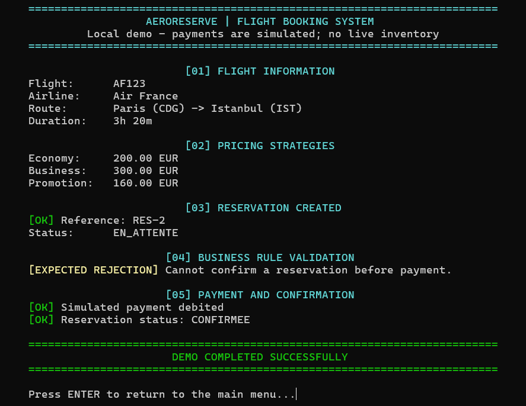
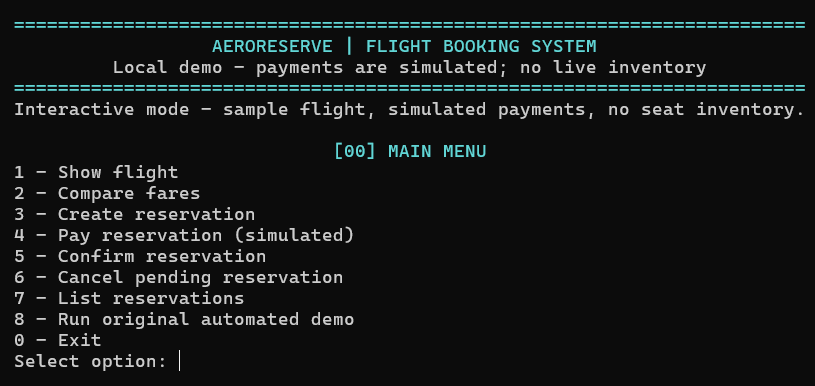

# AeroReserve — Java Flight Reservation System

[](https://github.com/ErkinTunc/AeroReserve-flight-booking/actions/workflows/main.yml)

**Flight booking rules, made explicit and testable.** AeroReserve is a Java 21 reservation domain model with an interactive terminal interface. It manages flight relationships, pricing policies, and reservation lifecycles while rejecting invalid operations.

## See it in action

<p align="center">
  
</p>

<details>
<summary><strong>View the interactive CLI menu</strong></summary>
<br>
<p align="center">
  
</p>
</details>

## Engineering Highlights

- **State Pattern:** Manages reservation states and prevents invalid transitions, such as confirming an unpaid booking.
- **Strategy & Factory Patterns:** Supports economy, business and promotional pricing without changing reservation logic.
- **Flight Management:** Maintains airline-flight relationships, prevents duplicate flight numbers and handles time zones.
- **Testing & CI:** Uses JUnit 5 for business rule validation and GitHub Actions for automated testing.


## Quick start

**Requirements:** Java 21. From the project root, on Windows PowerShell:

```powershell
# Run the test suite
.\gradlew.bat clean test

# Start the interactive menu
.\gradlew.bat --console=plain -q run

# Or run the automated booking demo
.\gradlew.bat --console=plain -q run --args="--demo"
```

On macOS/Linux, replace `.\gradlew.bat` with `./gradlew`.


## Architecture & Scope

The project is organized into three main packages:

- `demo/` — Interactive CLI and console output.
- `reservation/` — Reservations, payments, pricing and states.
- `aeroport/` — Airlines, flights, airports and routes.

Originally developed for a university Software Engineering course, AeroReserve currently runs locally with in-memory reservations and simulated payments.

**Current limitations:** No database persistence, REST API or seat inventory.

**Next step:** Implement concurrency-safe seat booking to prevent double reservations.

## Documentation

[Architecture](docs/flight_management/architecture-FlightManagement.md) · [Tests](docs/flight_management/tests-FlightManagement.md) · [Changelog](docs/flight_management/changelog.md) · [Roadmap](docs/Flight_Booking_Engineering_Roadmap.pdf)


**Tech:** `Java 21` · `Gradle` · `JUnit 5` · `Git` · `GitHub Actions (CI)`