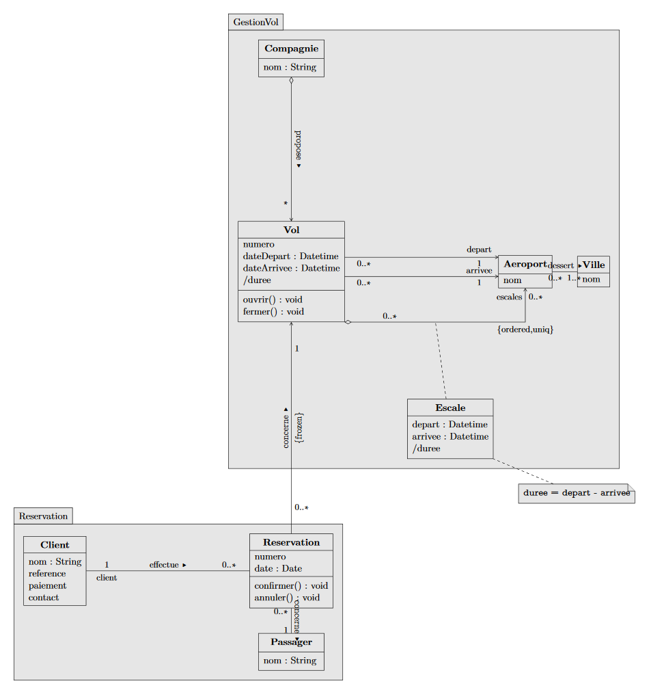

# AeroReserve — Flight & Reservation Management in Java

[](https://github.com/ErkinTunc/AeroReserve-flight-booking/actions/workflows/main.yml)

A Java-based **flight and reservation domain model** focused on a practical software engineering problem: **keeping airline, booking, and payment rules consistent as the system changes**.

Developed for a university Software Engineering course, AeroReserve separates reservation states, pricing policies, and flight relationships into testable components. It is an **object-oriented application with automated tests**, not a deployed airline booking website.

## Engineering Highlights

The project goes beyond representing airline entities: it implements business rules and tests the cases in which those rules could be broken.

| Engineering challenge                                 | Implementation                                                                                                                                                       | Evidence                                                                                                                                                                     |
| ----------------------------------------------------- | -------------------------------------------------------------------------------------------------------------------------------------------------------------------- | ---------------------------------------------------------------------------------------------------------------------------------------------------------------------------- |
| **Prevent invalid reservation operations**            | The **State pattern** allows payment before confirmation, permits cancellation while pending, and rejects forbidden transitions with `TransitionInterditeException`. | [Reservation tests](app/src/test/java/org/uca/reservation/model/ReservationTest.java) · [State tests](app/src/test/java/org/uca/reservation/state/ReservationStateTest.java) |
| **Keep flight ownership consistent**                  | Bidirectional `Compagnie`–`Vol` associations update both sides when flights are added, removed, or transferred. Flight numbers must be unique within an airline.     | [Airline tests](app/src/test/java/org/uca/aeroport/CompagnieTest.java) · [Flight tests](app/src/test/java/org/uca/aeroport/VolTest.java)                                     |
| **Change pricing without changing reservation logic** | The **Strategy pattern** isolates economy, business, and promotional fare calculations; `ReservationFactory` applies the chosen strategy during creation.            | [Factory tests](app/src/test/java/org/uca/reservation/model/ReservationFactoryTest.java)                                                                                     |
| **Reuse routes without duplicating their structure**  | Ordered, immutable `Trajet` steps can be shared across concrete `Vol` instances while retaining flight-specific departure times.                                     | [Route tests](app/src/test/java/org/uca/aeroport/TrajetTest.java)                                                                                                            |

## Features

- Flight and airline management, with company-specific flight-number uniqueness
- Airport, city, stopover, and ordered route modeling
- Time-zone-aware flight schedules and duration calculation
- Reservations that distinguish the **client** who books from the **passenger** who travels
- Automatic reservation reference generation through `ReservationFactory`
- Interchangeable pricing: economy, business, and promotional fares
- Validated reservation and payment lifecycles
- Input validation, domain invariants, and JUnit 5 regression tests
- Gradle build and GitHub Actions continuous integration

## Example: Business Rules in Action

### Reservation lifecycle

<p align="center">
  <em>
    A reservation begins in `EN_ATTENTE`. Only transitions permitted by its current state are accepted:
  </em>
</p>

<p align="center">
  
</p>

```text
EN_ATTENTE ── payer() ──> PAYEE ── confirmer() ──> CONFIRMEE
     │
     └──── annuler() ──> ANNULEE
```

For example, `confirmer()` on an unpaid reservation throws `TransitionInterditeException`. Cancelling a paid reservation is also forbidden in the **current simplified model**. These behaviors are covered by [unit tests](app/src/test/java/org/uca/reservation/model/ReservationTest.java), rather than demonstrated by the current command-line entry point.

### Pricing example

For a base fare of **100** (illustrative amount), the implemented strategies calculate:

| Policy          | Rule             | Result |
| --------------- | ---------------- | -----: |
| `TarifEco`      | Base price       |    100 |
| `TarifBusiness` | Base price + 50% |    150 |
| `TarifPromo`    | Base price − 20% |     80 |

The expected values are asserted in [ReservationFactoryTest](app/src/test/java/org/uca/reservation/model/ReservationFactoryTest.java).

## Architecture

<p align="center">
  
</p>

<p align="center">
  <em>
    Initial conceptual UML model. The Java implementation was subsequently
    refined to distinguish individual flights from reusable routes.
  </em>
</p>

```text
app/src/main/java/org/uca/
├── Start.java                 # Local flight/company demonstration
├── aeroport/                  # Companies, flights, airports, stopovers, routes
└── reservation/
    ├── model/                 # Reservations, clients, passengers, payments
    ├── pricing/               # Strategy-based fare policies
    └── state/                 # State-based reservation transitions
```

The separation of flight and reservation domains reduces coupling. In particular:

- **`Vol`** represents a concrete flight with dates, airports, and an airline association.
- **`Trajet` / `EtapeTrajet`** represent an ordered route and its relative timing, allowing reuse across flights.
- **`Escale`** represents a stopover at an airport, including its own arrival/departure times.
- **`Reservation`** delegates lifecycle decisions to state objects and retains its client, passenger, flight, price, and payment.
- **`ReservationFactory`** centralizes creation and pricing-policy selection.

For the rationale behind the relationships and patterns, see [Architecture & Design Decisions](docs/flight_management/architecture-FlightManagement.md).

## Documentation

- [Architecture & Design Decisions](docs/flight_management/architecture-FlightManagement.md)
- [Testing Strategy and Scenarios](docs/flight_management/tests-FlightManagement.md)
- [Development Changelog](docs/flight_management/changelog.md)
- [Engineering Roadmap (PDF)](docs/Flight_Booking_Engineering_Roadmap.pdf)

## How to run

1. > ./gradlew run

   Run with the run task, which assembles the application and executes some script or binary

2. > ./gradlew build

   Gradle builds for the build task to designate assembling all outputs and running all

3. > ./gradlew clean

   Delete the contents of the build directory using the clean task. Doing so will cause pre-computed outputs to be lost

- > ./gradlew test

  Runs the test task for all subprojects when invoked from the root project
  (if it is correct it should run all the tests and just show the summary of all test, if not it will only show the mistakes.)
  - > build/reports/tests/test/index.html

    To see the details of the tests on the browser.

---

## Testing and CI

Tests use **JUnit 5** to check both normal behavior and failure cases, including:

- Refusing duplicate flight numbers within a company
- Keeping airline/flight references synchronized after a transfer
- Rejecting invalid airports, dates, route steps, and reservation inputs
- Verifying correct prices for the three pricing strategies
- Rejecting confirmation before payment and other forbidden state transitions
- Checking payment debit and refund status changes

The actual Gradle test report is generated at:

```text
app/build/reports/tests/test/index.html
```

**Continuous integration:** [GitHub Actions](.github/workflows/main.yml) runs the Gradle build and tests using **Java 21** on pushes and pull requests to `main`.

## Project Goals

This project is a study of software engineering fundamentals that also matter in larger backend systems:

- Explicit domain rules and meaningful failure handling
- Object-oriented design and clear separation of responsibilities
- **State**, **Strategy**, and **Factory** design patterns
- Relationship integrity and defensive validation
- UML-based modeling and maintainable code organization
- Automated regression testing and continuous integration

## Tech Stack

`Java 21` · `Gradle` · `JUnit 5` · `Git` · `GitHub Actions (CI)`

## Current Status and Next Steps

**Current:** A Java domain-model application with unit tests and a small command-line demonstration of **flight/company behavior** through `Start.java`. Reservation lifecycles, payments, and pricing are implemented and exercised mainly through tests.

**Not implemented:** A customer-facing interface, an HTTP/REST API, database persistence, seat inventory, concurrency-safe seat booking, real payment-provider integration, or production deployment. No throughput or performance claim is made.

Potential next milestones, in order of demonstrable value:

1. Add a reproducible end-to-end **local reservation demo** (create → pay → confirm, plus a rejected operation).
2. Model seat availability and add tests for **competing booking requests**, with correctness verified before performance claims.
3. Explore persistence and a service/API layer if the project is extended beyond its academic domain-model scope.

See the [engineering roadmap](docs/Flight_Booking_Engineering_Roadmap.pdf) for broader planning notes. These are **future directions**, not completed features.
